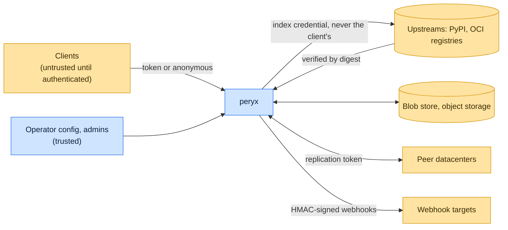

# Threat model

This model says what peryx trusts, where untrusted input enters, and which guarantees hold at each boundary, so a report
can be classified as a vulnerability or a bug. [SECURITY.md](SECURITY.md) covers reporting; if the two disagree,
SECURITY.md wins and we fix this file.

## How peryx works

Each `[[index]]` selects an ecosystem and a role: cached (fetches from an upstream on a miss, verifies the digest, and
serves later requests from local or object storage), hosted (accepts private uploads), or virtual (combines others).
Clients authenticate to peryx with a token that resolves to a principal; a grant of actions over resource globs, plus
each index's ACL, decides every request. peryx authenticates to an upstream with that index's own credential, never the
client's. In `dc` and `ha` modes peers replicate content and can serve a miss from a verified remote placement. See the
[access model](../site/content/core/access/authentication.md) and
[client versus upstream authentication](../site/content/core/access/access-explained.md).

## Compared with similar tools

We drew the boundary where comparable projects in other ecosystems draw theirs. The shared rule, stated by the
[Node.js threat model](https://github.com/nodejs/node/blob/main/SECURITY.md#the-nodejs-threat-model), is that a report
which first needs a trusted element compromised is out of scope; the first triage question, as
[DOMPurify](https://github.com/cure53/DOMPurify/blob/main/SECURITY.md#what-we-consider-a-vulnerability) puts it, is what
the attacker controls.

| Project                                                                                 | Language   | Where it draws the line                                                                                                                                                   |
| --------------------------------------------------------------------------------------- | ---------- | ------------------------------------------------------------------------------------------------------------------------------------------------------------------------- |
| [Harbor](https://github.com/goharbor/harbor/security/policy)                            | Go         | Confidentiality, integrity and privilege escalation come first, availability next; the defaults are not secure by themselves and operators must configure access control. |
| [Verdaccio](https://github.com/verdaccio/verdaccio/security/policy)                     | JavaScript | Private registry and upstream cache; reports go through Snyk.                                                                                                             |
| [distribution (registry)](https://github.com/distribution/distribution/security/policy) | Go         | The reference OCI registry; supports the latest release line and takes private reports.                                                                                   |
| [devpi](https://github.com/devpi/devpi)                                                 | Python     | The Python cache and private index peryx overlaps with; it publishes no security policy.                                                                                  |

## Trusted

An attacker who controls any of these already has what peryx could give them:

- The operator, the configuration file, environment and the administrator accounts.
- The host, the data directory, object storage and its credentials, and the replication token shared by peers.
- Upstream registries for what they publish, as long as the bytes match the digests they advertise.

## Untrusted inputs

| Input           | Comes from                               | What peryx guarantees                                                                          |
| --------------- | ---------------------------------------- | ---------------------------------------------------------------------------------------------- |
| Client requests | Anyone who can reach the listener        | A credential that matches no token is anonymous; every action needs a grant and the index ACL. |
| Upstream bytes  | Upstream registries and the network path | Stored and served only after their digest verifies.                                            |
| Peer content    | Other datacenters in `dc` and `ha` modes | Fetched only from verified placements and verified again by digest.                            |
| Uploads         | Token holders with `write`               | Accepted only into hosted indexes their grant covers.                                          |

## Threats and controls

| STRIDE                 | Threat                                                                             | Control                                                                                         |
| ---------------------- | ---------------------------------------------------------------------------------- | ----------------------------------------------------------------------------------------------- |
| Spoofing               | An invalid token is treated as a named principal.                                  | Unmatched credentials resolve to anonymous; rate limits use verified principals.                |
| Tampering              | A poisoned upstream response is cached.                                            | Digest verification before storage.                                                             |
| Information disclosure | A client's token is forwarded upstream, or a leaked metadata store exposes tokens. | Separate client and upstream credentials; scoped tokens are stored as SHA-256 verifiers.        |
| Denial of service      | Small unauthenticated requests exhaust memory or workers.                          | Bounded fan-out and attempts for peer fetches, and circuit breakers; report anything unbounded. |
| Elevation of privilege | A scoped token grants more than its creator holds.                                 | Creators can only grant actions and reach they hold.                                            |
| Repudiation            | A digest revocation cannot be traced.                                              | Each revocation records its reason, revision, timestamps and administrator ID.                  |

## Release chain

Releases are built by the release workflow from a tag the release App creates. Release assets are attested with GitHub
artifact attestations and verified before and after attestation, Python packages are attested and published to PyPI
through trusted publishing, and the GitHub Release is immutable. Every workflow pins third-party actions to a commit
SHA.

## Vulnerability or bug

| Report                                                                       | Verdict             | Why                                       |
| ---------------------------------------------------------------------------- | ------------------- | ----------------------------------------- |
| An anonymous client downloads from an index whose ACL denies anonymous reads | Vulnerability       | Access control bypass.                    |
| A cached index serves a malicious wheel PyPI published                       | Not a vulnerability | peryx caches what the upstream publishes. |
| A request with a bogus `Authorization` header gets a fresh rate-limit bucket | Vulnerability       | Limits must key on verified principals.   |
| The operator enables anonymous writes and someone uploads                    | Not a vulnerability | Operator choice.                          |
| Search results rank oddly                                                    | Bug                 | No boundary crossed.                      |

## Accepted risks

- peryx serves HTTP until TLS is configured; use HTTPS whenever clients cross a host or network boundary.
- Peers in `dc` and `ha` modes trust each other through the shared replication token.

## Keeping this current

Revisit this model when peryx gains a new input source, network access, a new way to run code, or a new place it writes
to, and whenever an advisory is published.
